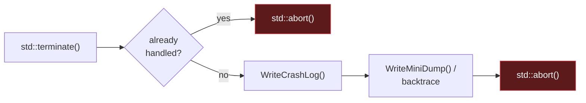

# Diagnostics — Assert & FatalReporter

Tiers 2 and 3 of the [three-tier diagnostic system](../../Core/README.md#-error-handling--diagnostics-the-three-tier-system). Both reuse the same `ErrorContext` that powers [`Result`](ErrorSystem.md).

## Contents

* [Assertions (Tier 2)](#assertions-tier-2)
* [Fatal Reporter (Tier 3)](#fatal-reporter-tier-3)

---

## Assertions (Tier 2)

`NU_ASSERT(expression, message)` checks internal engine invariants. In debug builds, a violated contract immediately prints the failed expression and source location, then triggers `NU_DEBUG_BREAK()` to stop the debugger. In release builds — or with assertions disabled — it compiles away entirely:

```cpp
#if !defined(NDEBUG) || defined(NU_ENABLE_ASSERTS)
    #define NU_ASSERT(expr, msg) \
        if (!(expr)) { \
            NuEngine::Core::Internal::TriggerAssert(#expr, __FILE__, __LINE__, msg); \
            NU_DEBUG_BREAK(); \
        }
#else
    #define NU_ASSERT(expr, msg) ((void)0)
#endif
```

---

## Fatal Reporter (Tier 3)

For truly unrecoverable states, NuEngine uses `FatalReporter`. It intercepts `std::terminate()` and leaves forensic evidence behind instead of silently vanishing:



`CrashInfo` records everything needed to reconstruct what happened afterward:

```cpp
struct CrashInfo
{
    StaticString<256> Reason;
    StaticString<256> Function;
    StaticString<256> File;

    uint32_t Line = 0;
    uint32_t ThreadID = 0;
    int64_t Timestamp = 0;

    static constexpr uint8_t MaxTraceDepth = 16;
    std::array<ErrorContext, MaxTraceDepth> TraceFrames{};
    uint8_t TraceCount = 0;
};
```

| Recorded | Detail |
|---|---|
| Context | Failure reason, thread ID, timestamp |
| Location | Source file, function, line |
| Trace | Up to 16 stack frames |

| Platform | Artifacts written |
|---|---|
| 🪟 Windows | `crash.log` + Minidump (`crash.dmp`) |
| 🐧 Linux / 🍎 macOS | `crash.log` + raw backtrace (`crash_stack.log`) |

`FatalReporter::Install()` hooks `std::set_terminate` once, at startup. `Crash()` captures and writes the evidence before aborting:

```cpp
void FatalReporter::Install() noexcept
{
    std::set_terminate([]() noexcept
        {
            if (g_handled.exchange(true)) std::abort();
            WriteCrashLog(g_crashInfo);
            WriteMiniDump();
            std::abort();
        });
}

void FatalReporter::Crash(std::string_view reason, const std::source_location& loc) noexcept
{
    CrashInfo info;
    info.Reason = reason;
    info.File = loc.file_name();
    // ...
    info.TraceFrames[0] = ErrorContext{ nullptr, loc };
    info.TraceCount = 1;
    ReportAndDie(info);
}
```

`LOG_FATAL` ties both systems together in one macro: the message is written to the normal log stream, then `FatalReporter` takes over and ends the program leaving evidence behind:

```cpp
#define LOG_FATAL(...)                                                       \
    do {                                                                     \
        auto _msg_ = std::format(__VA_ARGS__);                               \
        auto _loc_ = std::source_location::current();                        \
        NuEngine::Core::Logger::Log(                                         \
            NuEngine::Core::LogLevel::Fatal, _msg_, _loc_);                  \
        NuEngine::Core::FatalReporter::Crash(_msg_, _loc_);                  \
    } while(0)
```

---

[← Back to README](../../Core/README.md)