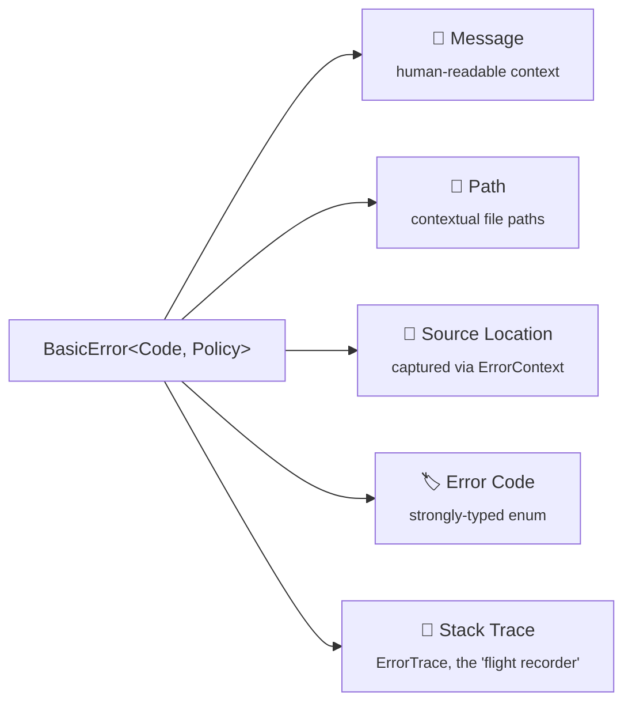
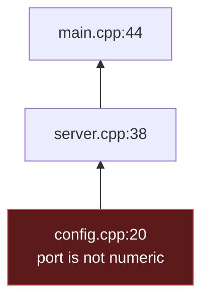
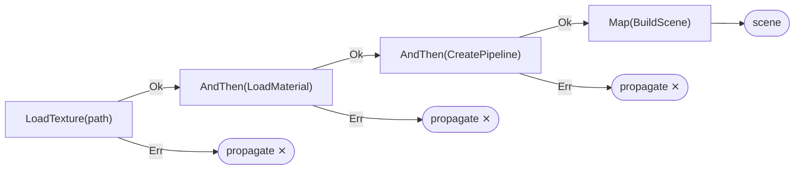

# Error System — `Result` / `BasicError`

`Result<T, E>` is NuEngine's exception-free error type. It's the front door for recoverable errors — Tier 1 of the [three-tier diagnostic system](../../Core/README.md#-error-handling--diagnostics-the-three-tier-system).

## Contents

* [Why not `std::expected`?](#why-not-stdexpected)
* [Error Anatomy & Policies](#error-anatomy--policies)
* [Error Propagation — `NU_TRY`](#error-propagation--nu_try)
* [`Result<void>`](#resultvoid)
* [Monadic Operations](#monadic-operations)
* [Performance & Benchmarks](#performance--benchmarks)

---

## Why not `std::expected`?

Three reasons, in order of how hard they'd be to bolt on after the fact.

### Availability

`std::expected` is a C\++23 feature. NuEngine targets C\++20 to guarantee it compiles on current console SDKs and studio CI pipelines *today*, rather than waiting on toolchains to catch up. The library already leans on other C++20 features, so this is a deliberate ceiling, not a limitation:

```cpp
template <typename P>
concept ErrorPolicyConcept = requires
{
    typename P::Message;
    typename P::Path;
    typename P::Trace;
    typename P::SystemError;
};
```

### Storage

`std::expected` is just a wrapper box — nothing stops you from writing `std::expected<Texture, FileSystemError>` and getting the same error type underneath. The actual value in NuEngine's system is the payload: `ErrorPolicy`, `ErrorContext`, `ErrorTrace`. Since custom internal storage was needed anyway, wrapping it in a custom `Result` gives full control over both the contents *and* the box.

### Propagation

When an error passes through `NU_TRY`, it automatically captures the source location and pushes a stack frame onto the error trace. That behavior can't be bolted onto the standard library's type from the outside — it has to be part of the type itself:

```cpp
#define NU_TRY(var, expr)                                        \
    auto var##_result_ = (expr);                                 \
    if (var##_result_.IsError()) [[unlikely]]                    \
    {                                                            \
        auto _err_ = std::move(var##_result_.UnwrapError());     \
        _err_.AddFrame(NuEngine::Core::ErrorContext{});          \
        return NuEngine::Core::Err(std::move(_err_));            \
    }                                                            \
    auto var = std::move(var##_result_.Unwrap())
```

> **In short:** `std::expected` is one possible box. `Result<T, E>` needed the contents, the propagation behavior, and a guarantee it compiles today — not once a future toolchain update lands.

---

## Error Anatomy & Policies

An error is only as useful as the information it carries. A fully-featured `BasicError` is built from five pieces:



```cpp
struct ErrorContext
{
    const char* File = nullptr;
    const char* Function = nullptr;
    uint32_t Line = 0;
    const char* Module = nullptr;

    constexpr ErrorContext(const char* module = nullptr,
        const std::source_location& loc = std::source_location::current()) noexcept
        : File(loc.file_name())
        , Function(loc.function_name())
        , Line(loc.line())
        , Module(module)
    {
    }
};
```

`BasicError` is templated on both the error code enum and an `ErrorPolicy`, so the same type can be razor-thin or fully detailed depending on where it's used:

```cpp
template<ErrorCode CodeEnum, ErrorPolicyConcept Policy = RichErrorPolicy>
class BasicError
{
public:
    using Code_t = CodeEnum;
    using Policy_t = Policy;
    using Trace_t = typename Policy::Trace;
    // ...
};
```

Pick a policy based on how much diagnostic weight you're willing to pay for:

| Policy | Size | Relative footprint | Stores | Intended use |
|---|--:|---|---|---|
| `CompactErrorPolicy` | ~3 B | `▓` | Error code only | Hot loops, gameplay code |
| `MediumErrorPolicy` | 144 B | `▓▓▓▓▓▓▓▓▓▓▓▓▓▓▓▓▓▓▓▓▓▓▓▓▓▓▓▓▓▓▓▓` | Code, inline message, 2-frame trace | General engine systems |
| `RichErrorPolicy` *(default)* | 672 B | `▓▓▓▓▓▓▓▓▓▓▓▓▓▓▓▓▓▓▓▓▓▓▓▓▓▓▓▓▓▓▓▓▓▓▓▓▓▓▓▓▓▓▓▓▓▓▓▓▓▓▓▓▓▓▓▓▓▓▓▓▓▓▓▓` | Code, message, path, `std::error_code`, 8-frame trace | Filesystem, assets, networking |

A code is for your code; a message is for humans:

```cpp
if (err == FileSystemErrorCode::FileNotFound)
{
    return LoadFallbackTexture();
}
```

---

## Error Propagation — `NU_TRY`

`NU_TRY` propagates failures while appending stack information at each level:

```cpp
Result<int, FileSystemError> LoadServerConfig()
{
    NU_TRY(port, ReadPortFromDisk());
    return Ok(port);
}
```

A deeply nested failure accumulates its call chain as it unwinds:



```text
[FileSystemError][Error] port is not numeric
Path: 80x1
Trace:
    [0] config.cpp:20
    [1] server.cpp:38
    [2] main.cpp:44
Code: Invalid path
```

Same principle, real subsystem:

```text
[FileSystem][Error] Failed to load texture
  Path: Assets/UI/logo.png
  Trace:
     [0] TextureLoader.cpp:143
```

---

## `Result<void>`

Functions that only report success or failure return `Result<void, E>`:

```cpp
Result<void, FileSystemError> ValidatePath(std::string_view path)
{
    if (path.empty())
        return Err(FileSystemError(FileSystemErrorCode::InvalidPath, "path is empty"));
    return Ok();
}
```

---

## Monadic Operations

The API provides a functional interface (`Map`, `AndThen`, `ValueOr`, etc.). `AndThen` and `NU_TRY` are the same underlying logic — one check, one branch — so pick whichever fits: a chain, or an intermediate value.

```cpp
auto scene = LoadTexture(path)
    .AndThen(LoadMaterial)
    .AndThen(CreatePipeline)
    .Map(BuildScene);
```



No magic behind it — `AndThen` is a single branch over the same state `NU_TRY` checks:

```cpp
template <typename F>
constexpr auto AndThen(F&& func) const&
    -> std::invoke_result_t<F, const T&>
{
    if (IsError())
    {
        return ErrWrapper<E>{ m_data.Err_() };
    }
    return std::invoke(std::forward<F>(func), m_data.Ok_());
}
```

---

## Performance & Benchmarks

`RichErrorPolicy`'s extra safety and detail doesn't cost performance on the happy path — you only pay for the diagnostic weight when an error actually occurs. Same backpack either way; it's just empty on a normal hike.

> **Methodology:** 2,000,000 repetitions per case, 7 runs, trimmed mean (best and worst dropped), built with `-O3`, cross-checked against the engine's own analytical cost model rather than measured in isolation.

**Happy path parity** — `Result<T, RichError>` is practically identical to `std::expected` on success:

| Type | Time | |
|---|--:|---|
| `Result<T, RichError>` | 2.30 ns | `▓▓▓▓▓▓▓▓▓▓▓▓▓▓▓▓▓▓▓▓▓▓▓▓▓▓▓▓▓▓▓▓▓▓▓▓▓▓▓▓▓▓` |
| `std::expected<T, Error>` | 2.29 ns | `▓▓▓▓▓▓▓▓▓▓▓▓▓▓▓▓▓▓▓▓▓▓▓▓▓▓▓▓▓▓▓▓▓▓▓▓▓▓▓▓▓▓` |

**Consistent across payload sizes** — the same operation set (ctor/dtor, chaining, copy/move, `MapError`, `ValueOr`, error propagation, mixed workloads) measured across `Small`, `Medium`, `Large` payloads. The ratio against the cost model stays within a couple percent almost everywhere, including the error path, which barely moves regardless of `T`:

| Payload | Operation | Time | Ratio vs. model |
|---|---|--:|:--:|
| Small | ctor+dtor(Ok) | 0.92 ns | 1.00 ✅ |
| Medium | ctor+dtor(Ok) | 0.46 ns | 1.00 ✅ |
| Large | ctor+dtor(Ok) | 57.97 ns | 1.02 ✅ |
| Small | error chain | 0.15 ns | 1.00 ✅ |
| Medium | error chain | 0.15 ns | 1.00 ✅ |
| Large | error chain | 0.17 ns | 1.00 ✅ |
| Medium | copy assign | 0.69 ns | 0.09 🟢 *(better than modeled)* |
| Medium | move assign | 0.47 ns | 0.67 🟢 *(better than modeled)* |

A couple of rows land *better* than modeled — copy-assigning a `Medium` `Result` measured at roughly a ninth of its budgeted cost, thanks to compiler elision the model didn't assume. Reported as-is, not smoothed over.

**Construction strategy** — for a `Large` payload (`std::string` + `std::vector<int>`), *how* you construct the `Result` matters slightly:

| Construction | Time | vs. `std::expected` |
|---|--:|:--:|
| `Ok(x)` | 44.88 ns | +4% |
| `Result(std::in_place, x)` | 43.62 ns | ~0% |
| `MakeResultOk<T, E>(x)` | 43.14 ns | ~0% |
| `std::expected<T, E>(x)` *(baseline)* | 43.29 ns | — |

`Ok(x)` adds one extra move of `T` through the wrapper. `Result(std::in_place, x)` and `MakeResultOk(x)` construct `T` directly in `Result`'s own storage — the same technique `std::expected`'s converting constructor uses. **Prefer the in-place constructors in hot paths.**

**The void advantage** — one place `Result` doesn't just match `std::expected`, it beats it:

| Operation | `Result<void, E>` | `std::expected<void, E>` | Ratio |
|---|--:|--:|:--:|
| ctor(Ok) | 0.25 ns | 0.74 ns | **0.34** 🚀 |
| ctor(Err) | 0.25 ns | 0.74 ns | **0.34** 🚀 |
| chain | 0.20 ns | 0.20 ns | 0.99 |
| error chain | 0.16 ns | 0.16 ns | 1.00 |

`Result<void, E>` construction runs at roughly a third the cost of `std::expected<void, E>` — no payload means nothing for the wrapper to move or copy, and the compiler collapses the layout more aggressively than `std::expected`'s tag-and-union representation. The gap is purely construction-time; both converge once you start chaining.

---

[← Back to README](../../Core/README.md)