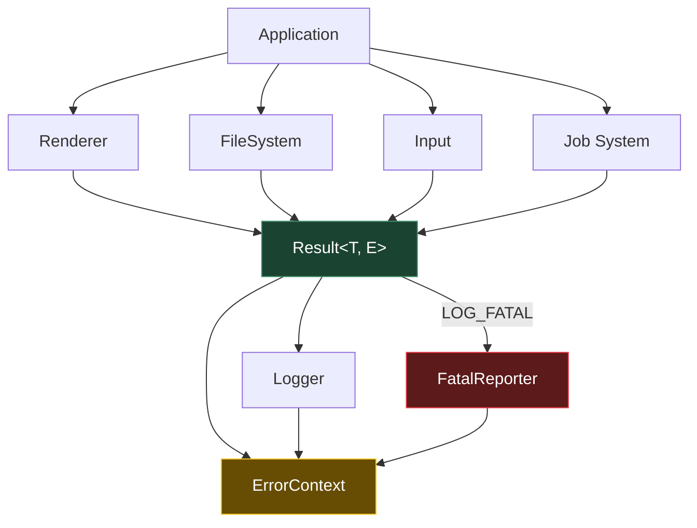
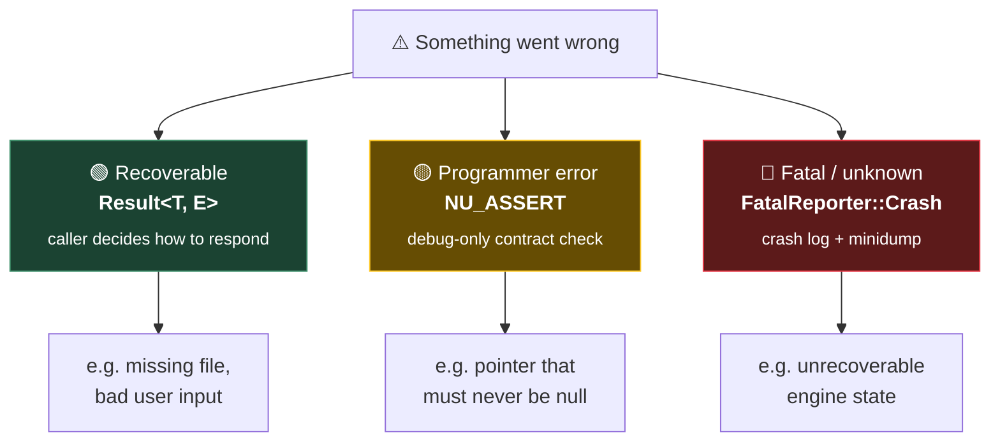

<div align="center">

# NuEngine::Core

**Core infrastructure library for NuEngine**

[](#requirements)
[](#overview)
[](#overview)
[](#requirements)
[](#requirements)
[](#license)

</div>

`NuEngine::Core` provides the low-level building blocks shared by every engine subsystem: error handling, diagnostics, logging, filesystem, input, timing, memory, containers, and multithreading. Every other subsystem depends on it, so correctness, performance, and predictability come first — dynamic allocation, exceptions, and unnecessary runtime overhead are avoided wherever possible.

Its centerpiece is a single diagnostic ecosystem rather than three unrelated tools: errors, assertions, and crash reports all speak the same vocabulary, built around `ErrorContext` and `ErrorTrace`.

<div align="center">

<table>
<tr>
<td align="center" width="25%">🚫<br><b>Allocation-free</b><br><sub>wherever practical</sub></td>
<td align="center" width="25%">🛡️<br><b><code>noexcept</code>-first</b><br><sub>APIs throughout</sub></td>
<td align="center" width="25%">⚙️<br><b><code>constexpr</code>-friendly</b><br><sub>implementation</sub></td>
<td align="center" width="25%">⚡<br><b>Zero-cost</b><br><sub>abstractions for runtime-critical code</sub></td>
</tr>
</table>

| Status | |
|---|---|
| ✅ | C++20 |
| ✅ | Exception-free design |
| ✅ | Allocation-free where possible |
| ✅ | Cross-platform |
| ✅ | Unit-tested |
| ⚠️ | Some modules are still under development |

</div>

---

## 📑 Contents

* [Quick Start](#-quick-start)
* [Overview](#overview)
* [Architecture](#-architecture)
* [Error Handling & Diagnostics — The Three-Tier System](#-error-handling--diagnostics-the-three-tier-system)
* [Modules](#-modules)
* [Design Rationale](#-design-rationale)
* [Requirements](#-requirements)
* [License](#-license)

---

## 🚀 Quick Start

```cpp
Result<Texture, FileSystemError> tex = LoadTexture(path);

if (tex.IsError())
{
    LOG_ERROR("{}", tex.UnwrapError());
    return;
}

UseTexture(tex.Unwrap());
```

That's the whole idea: `Result<T, E>` instead of exceptions, checked explicitly, with the error carrying enough context to actually explain itself. Everything below builds on that one pattern.

---

## Overview

`NuEngine::Core` is the foundational module of NuEngine. Instead of treating errors as an afterthought, they're integrated with assertions and crash reporting into one system — three tiers of severity sharing a common vocabulary, rather than three tools bolted together after the fact.

---

## 🏗 Architecture

Every subsystem reports failures through the same `Result` / `ErrorContext` pipeline, and both `Logger` and `FatalReporter` are built on top of it — not next to it:



Subsystems don't know or care about `Logger` or `FatalReporter` directly — they just return a `Result`. What happens with a failure (logged, escalated, or left for the caller to handle) is decided above them.

---

## 🧭 Error Handling & Diagnostics — The Three-Tier System

Not every failure deserves the same treatment, so NuEngine splits diagnostics into three severity tiers sharing the same building blocks:



| Tier | Type | Trigger | Behavior |
|:--:|---|---|---|
| 1 · Recoverable | `Result<T, E>` | Expected issues the caller can act on (e.g. a missing file) | Returned normally, caller decides how to respond |
| 2 · Programmer error | `NU_ASSERT` | Strict contract violations (e.g. a pointer that must never be null) | Stops the debugger immediately in debug builds; compiles to nothing in release |
| 3 · Fatal / unknown | `FatalReporter` | Unrecoverable engine states | Terminates gracefully, saving crash logs and minidumps first |

`Result`'s trace, `NU_ASSERT`'s reporting, and `FatalReporter`'s crash dumps all reuse the same `ErrorContext` (captured via `std::source_location`), so every tier speaks the same diagnostic language. Full details for each tier live in their own docs, linked below.

---

## 📦 Modules

| Module | Summary | Docs |
|---|---|---|
| **Result / BasicError** | Exception-free error type: policies, `NU_TRY` propagation, monadic ops, and benchmarks against `std::expected` | [Docs/Core/ErrorSystem.md](../../Docs/Core/ErrorSystem.md) |
| **Diagnostics** | `NU_ASSERT` for contract violations, `FatalReporter` for unrecoverable crashes with minidumps | [Docs/Core/Diagnostics.md](../../Docs/Core/Diagnostics.md) |
| **Logging** | Thread-safe `Logger`, reports its own init failures through `Result` like everything else | [Docs/Core/Logger.md](../../Docs/Core/Logger.md) |
| **Input** | 🚧 Documentation coming soon | — |
| **FileSystem** | 🚧 Documentation coming soon | — |
| **Time** | 🚧 Documentation coming soon | — |
| **Timer** | 🚧 Documentation coming soon | — |
| **Job System** | 🚧 Documentation coming soon | — |
| **Containers** | 🚧 Documentation coming soon | — |
| **Memory / Allocators** | 🚧 Documentation coming soon | — |

---

## 🌍 Design Rationale

How `Result<T, E>` compares to exceptions, Unreal's macros, Unity, and Rust's approach — see [Docs/Core/DesignRationale.md](../../Docs/Core/DesignRationale.md).

---

## 🧱 Requirements

* C++20
  * `std::source_location`
  * `std::format`
  * Concepts

### Supported Compilers

| Compiler | Status |
|---|:--:|
| MSVC | ✅ Tested |
| GCC 13+ | ✅ Tested |
| Clang | ⚠️ Planned |

---

## 📄 License

Copyright © 2025 **Vladyslav Hordiychuk**.

All rights reserved.